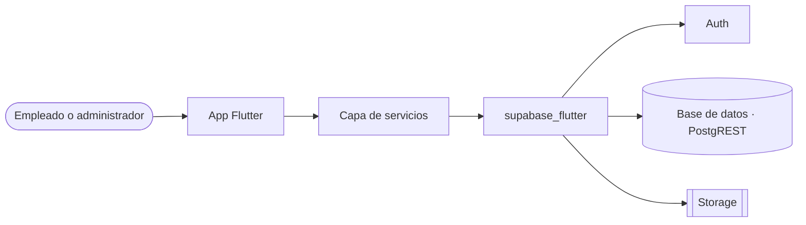

# Architectural spine · Plataforma inteligente para el análisis del mercado automotor colombiano

## Resumen

Aplicación en Flutter que permite a los empleados buscar, ver y comparar anuncios de vehículos de un portal externo, y a un administrador gestionar las cuentas de esos empleados. Corre en celular (Android) y en web, con prioridad en celular. Todo el backend es Supabase: Auth, base de datos y Storage.

## Diagrama

## Stack

- Frontend: Flutter 3.x y Dart 3.x. Plataformas: web y Android.
- SDK: `supabase_flutter`.
- Backend: Supabase con Auth, base de datos (Postgres + PostgREST) y Storage.

## Qué cubre cada servicio

- **Auth**: inicio y cierre de sesión de empleados y administrador, y creación de las cuentas de empleados.
- **Base de datos**: los usuarios con su rol (empleado o administrador) y los anuncios de vehículos con sus atributos, el publicador y su procedencia (detalle en `docs/modelo.md`, aún no existe).
- **Storage**: las fotos de perfil de los usuarios, en un bucket de perfiles. Ningún requisito las pide todavía (ver *Diferido*).

## Invariantes

### AD-01 · Sin backend propio

- **Regla:** la app habla directo con Supabase.
- **Evita:** montar un servidor aparte para una sola pantalla.

### AD-02 · Una capa de servicios

- **Regla:** solo los servicios de la app llaman a Supabase; las pantallas les piden los datos.
- **Evita:** consultas repetidas y distintas a lo mismo regadas por las pantallas.

### AD-03 · El usuario es el de Auth

- **Regla:** cada usuario de la plataforma es una cuenta de Auth, y la fila de usuario guarda el `uuid` de Auth y su rol.
- **Evita:** dos identidades para la misma persona.

### AD-04 · Acceso por sesión y por rol

- **Regla:** la app solo muestra anuncios a quien tiene sesión iniciada, y solo muestra el módulo administrativo al rol administrador. No hay registro libre: las cuentas de empleados las crea el administrador.
- **Evita:** que alguien ajeno consulte los anuncios o que un empleado gestione cuentas.

### AD-05 · Una sola estructura de anuncio, con lo ausente como ausente

- **Regla:** todo anuncio se guarda con el mismo conjunto de atributos, sin importar cómo lo presente el portal. Un atributo sin valor se guarda y se pasa como ausente, nunca como 0 ni como valor supuesto.
- **Evita:** fichas y comparaciones con formatos distintos, o datos inventados que parecen reales.

### AD-06 · La app solo lee los anuncios

- **Regla:** los anuncios los carga la obtención automática; la app únicamente los consulta.
- **Evita:** que la interfaz altere los datos con los que se compara.

### AD-07 · Procedencia en cada anuncio

- **Regla:** todo anuncio guarda su portal de origen, su identificador en ese portal y la fecha en que se obtuvo (RF-26).
- **Evita:** anuncios repetidos al volver a obtenerlos, y no saber de dónde viene un dato ni qué tan reciente es.

### AD-08 · Los archivos van en Storage

- **Regla:** la fila guarda solo la ruta del archivo, no el archivo.
- **Evita:** guardar imágenes dentro de la base de datos.

### AD-09 · Llaves fuera del código

- **Regla:** la URL y la publishable key se leen de la configuración, no se escriben en cada archivo. La secret key nunca va en la app ni en el repositorio.
- **Evita:** filtrar credenciales, o cambiar de proyecto editando diez archivos.

## Diferido

- **Obtención automática de anuncios:** qué la ejecuta, dónde corre y cómo escribe en la base. La spine no nombra ningún servicio para esto; se decide después de la prueba técnica del portal (PRD, *Preguntas abiertas*).
- **Creación de cuentas por el administrador:** la secret key no puede ir en la app (AD-09), así que falta decidir cómo se crean las cuentas desde el módulo administrativo.
- **Seguridad por filas (RLS):** no se usa en el curso, por lo que AD-04 se aplica en la app y no lo hace cumplir el servidor. Revisarlo antes de manejar datos reales del publicador.
- **Fotos de perfil:** Storage está en el stack, pero ningún requisito las pide. Confirmar si entran en el MVP o se retiran.
- **Funciones en el servidor y tiempo real:** no se usan.
- **`docs/modelo.md`:** pendiente.

## Historial

- 0.1.1 · 2026-11-06 · Se alinea con los requisitos 0.2.0 (RF-26).
- 0.1.0 · 2026-11-06 · Primera versión.
